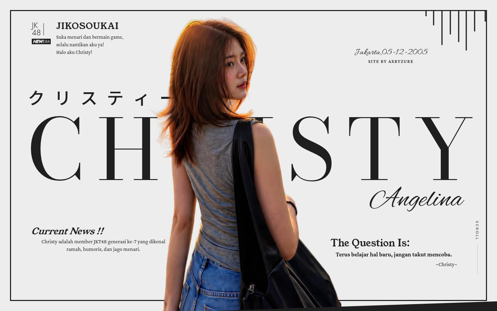
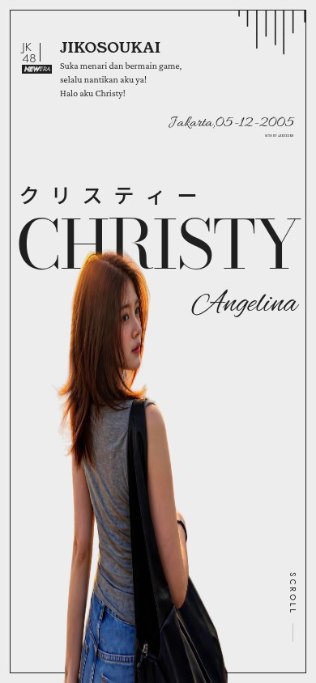
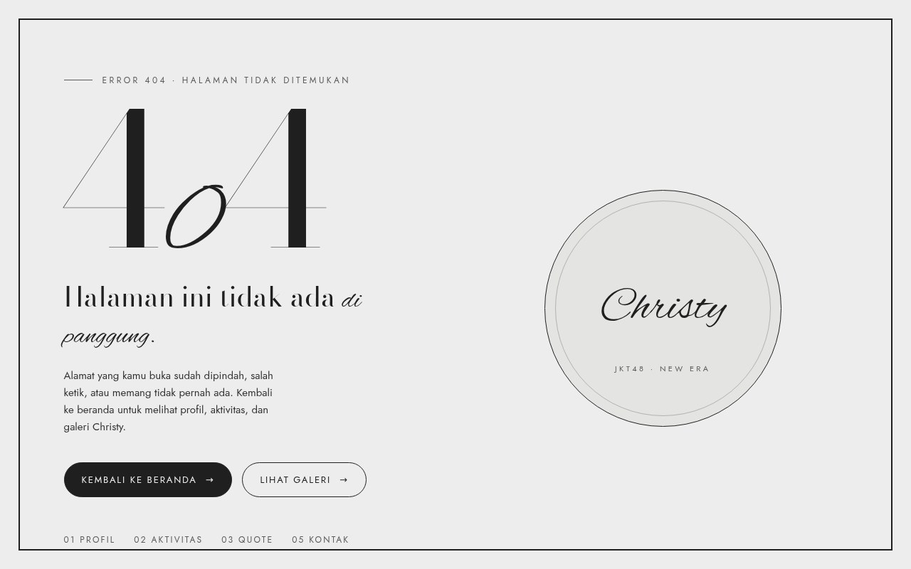
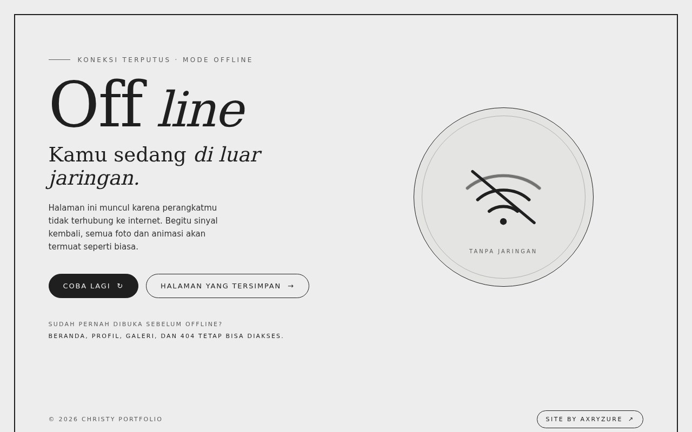
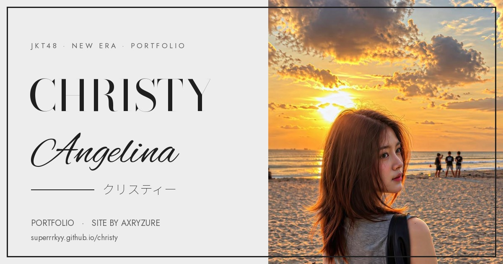
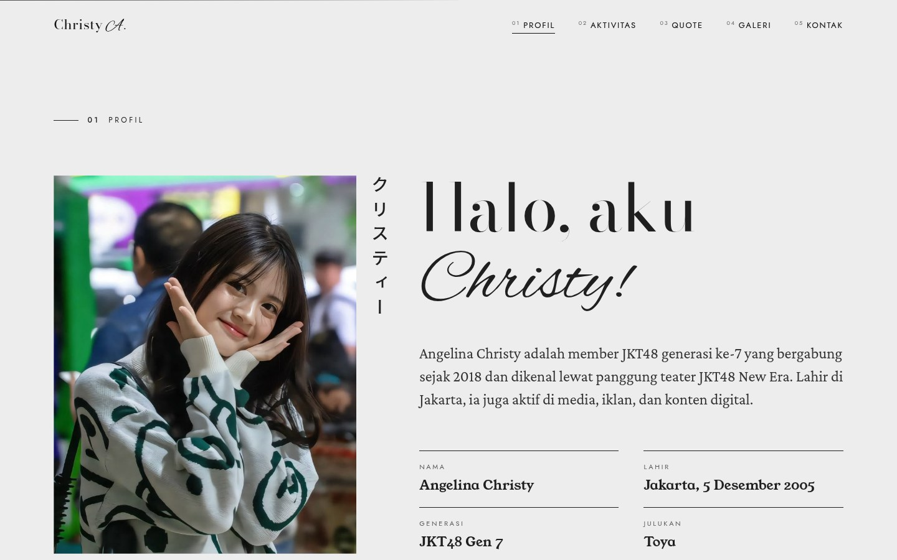
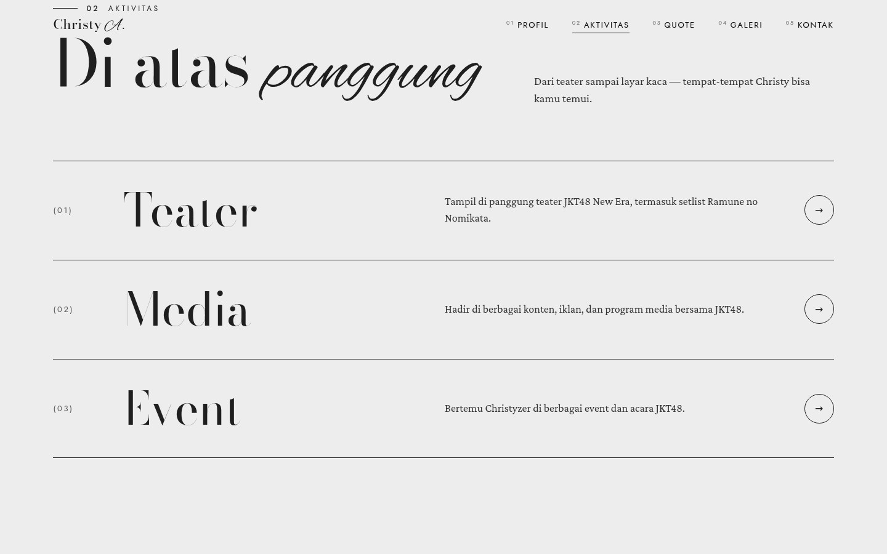
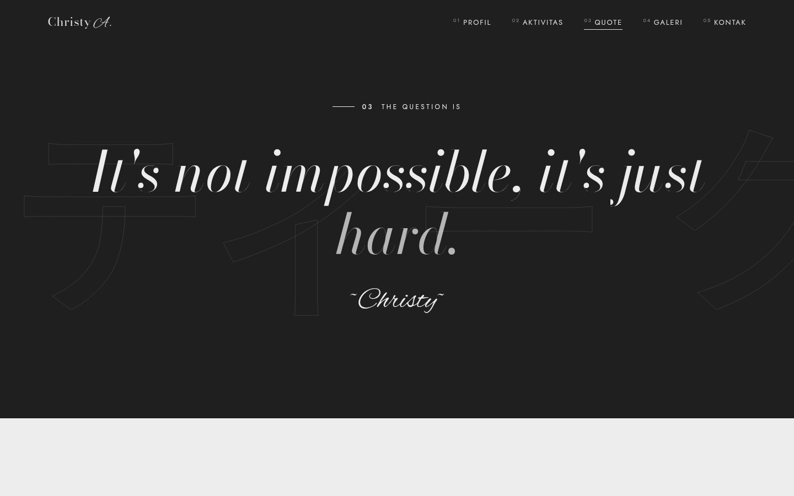
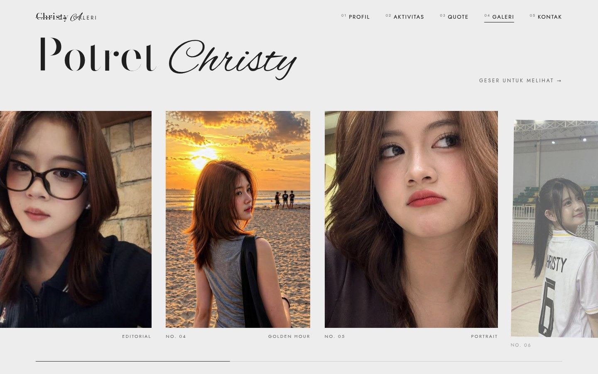
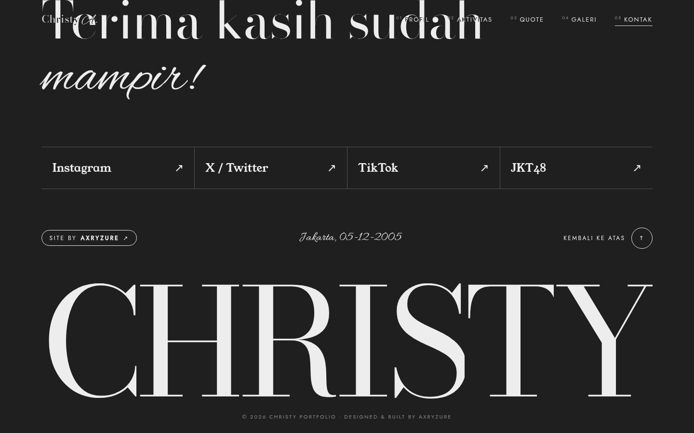

<!--
  README ini tersedia dalam dua bahasa:
  · Bahasa Indonesia  → README.md
  · English           → README.en.md
  Bahasa default (README.md) berisi Bahasa Indonesia.
-->

<div align="center">



<br />
<br />

# CHRISTY — Portfolio

**Portofolio digital Christy (Angelina Christy), member JKT48 New Era.**
Satu halaman, satu poster, penuh gerak.

<br />

[](https://superrrkyy.github.io/christy/)
[](https://superrrkyy.github.io/christy/)
[](#-menjalankan-di-komputer-sendiri)
[](#-mode-offline)
[](#-english-version)

<br />

[**Situs Live**](https://superrrkyy.github.io/christy/) · [Profil](#-tentang-proyek) · [Aktivitas](#-bagian-halaman) · [Galeri](#-galeri) · [Dokumentasi](#-struktur-folder) · [English](README.en.md)

</div>

<br />

> [!TIP]
> **Mau lihat langsung?** Buka **[superrrkyy.github.io/christy](https://superrrkyy.github.io/christy/)** — tidak perlu install apa pun.
> Situs ini juga bisa dibuka **tanpa internet** setelah dikunjungi sekali (lihat [Mode Offline](#-mode-offline)).

<br />

## Daftar Isi

- [Tentang Proyek](#-tentang-proyek)
- [Teknologi yang Dipakai](#-teknologi-yang-dipakai)
- [Bagian Halaman](#-bagian-halaman)
- [Galeri](#-galeri)
- [Tampilan di Berbagai Perangkat](#-tampilan-di-berbagai-perangkat)
- [Halaman 404](#-halaman-404)
- [Mode Offline](#-mode-offline)
- [Pratinjau Tautan (Open Graph)](#-pratinjau-tautan-open-graph)
- [Struktur Folder](#-struktur-folder)
- [Menjalankan di Komputer Sendiri](#-menjalankan-di-komputer-sendiri)
- [Deploy / Publikasi](#-deploy--publikasi)
- [Mengubah Isi Situs](#-mengubah-isi-situs)
- [Performa & Optimasi](#-performa--optimasi)
- [Aksesibilitas](#-aksesibilitas)
- [Hasil Pengujian](#-hasil-pengujian)
- [Pertanyaan Umum](#-pertanyaan-umum)
- [Lisensi & Kredit](#-lisensi--kredit)
- [English Version](#-english-version)

<br />

## ✦ Tentang Proyek

Situs ini adalah **portofolio satu halaman** (single-page portfolio) untuk **Christy** — *Angelina Christy*, member **JKT48 generasi ke-7** yang dikenal lewat panggung **JKT48 New Era**, media, dan konten digital.

Desainnya sengaja dibuat seperti **poster majalah hidup**: tipografi serif raksasa, foto potongan (*cutout*) yang bergerak mengikuti kursor, marquee berjalan, galeri yang bergeser horizontal saat di-scroll, dan bagian quote gelap yang menyala kata demi kata.

| | |
|---|---|
| **Subjek** | Christy (Angelina Christy) — JKT48 New Era, generasi ke-7 |
| **Jenis** | Portofolio satu halaman, statis, tanpa backend |
| **Dibuat oleh** | **[axryzure](https://github.com/superrrkyy)** |
| **Status** | ✅ Live — [superrrkyy.github.io/christy](https://superrrkyy.github.io/christy/) |
| **Bahasa konten** | Indonesia |
| **Biaya operasional** | Rp0 (GitHub Pages) |

<br />

## ✦ Teknologi yang Dipakai

<div align="center">

| Teknologi | Peran dalam proyek | Logo |
|:---|:---|:---:|
| **HTML5** | Struktur halaman, elemen semantik (`<main>`, `<figure>`, `<dl>`), metadata Open Graph |  |
| **CSS3** | Tata letak (Grid & Flexbox), custom properties, `clamp()` fluid typography, `aspect-ratio`, animasi `@keyframes`, `prefers-reduced-motion` |  |
| **JavaScript (ES6+)** | Logika interaksi: loader, scroll-spy, menu mobile, parallax |  |
| **GSAP 3.12.5** | Engine animasi utama — timeline intro, reveal, efek magnet tombol |  |
| **GSAP ScrollTrigger** | Animasi berbasis scroll, *pinning* galeri horizontal, progress bar |  |
| **Service Worker** | Mode offline, cache aset, fallback halaman `offline.html` |  |
| **Web App Manifest** | Bisa dipasang ke home screen (PWA), ikon, warna tema |  |
| **GitHub Pages** | Hosting gratis, HTTPS otomatis, deploy dari branch `main` | <picture><source media="(prefers-color-scheme: dark)" srcset="https://cdn.simpleicons.org/github/ededed"><source media="(prefers-color-scheme: light)" srcset="https://cdn.simpleicons.org/github/181717"></picture> |
| **Git & GitHub** | Version control + kolaborasi |  |

</div>

<br />

### Font (Google Fonts)

| Font | Dipakai untuk | Logo |
|:---|:---|:---:|
| **Bodoni Moda** | Judul raksasa "CHRISTY", heading bagian, angka 404 |  |
| **Alex Brush** | Tulisan tangan script — *Angelina*, *Potret*, *mampir!* | ✒️ |
| **Allura** | Aksen script kecil — tanggal, tanda tangan quote | ✒️ |
| **Young Serif** | Sub-judul bergaya editorial | ✒️ |
| **Jost** | Teks UI, label, navigasi, badge | ✒️ |
| **Noto Sans JP** | Nama Jepang **クリスティー** | 🇯🇵 |
| **Crimson Pro** | Teks paragraf panjang | ✒️ |

<br />

### Alat Bantu (Development)

| Alat | Fungsi di proyek ini |
|:---|:---|
| **Python 3** (`http.server`) | Server lokal sekali pakai untuk menguji situs |
| **rembg + ONNX Runtime** | Menghapus latar foto hero → menghasilkan `christy.webp` transparan |
| **Pillow (PIL)** | Crop, resize, dan kompresi seluruh foto + pembuatan ikon & poster OG |
| **Playwright / Chromium** | Pengujian otomatis: overflow, gambar rusak, mode offline, aksesibilitas |
| **GitHub REST API** | Membuat repo & mengaktifkan Pages secara otomatis |

<br />

## ✦ Bagian Halaman

Situs terdiri dari 5 bagian utama + footer. Semua di satu halaman, dihubungkan dengan navigasi ber-scroll.

| # | Bagian | Isi | Gambar |
|:---:|:---|:---|:---|
| **00** | **Hero** | Wordmark **CHRISTY** per huruf, nama Jepang クリスティー, foto cutout parallax, tanggal & kredit "Site by axryzure", marquee berjalan | [lihat](docs/01-hero.jpg) |
| **01** | **Profil** | Foto potret + nama Jepang vertikal, sambutan "Halo, aku *Christy!*", bio, 4 kartu fakta (nama, lahir, generasi, julukan), jiko (perkenalan diri) | [lihat](docs/02-profil.jpg) |
| **02** | **Aktivitas** | Tiga baris aktivitas — *Teater*, *Media*, *Event* — dengan foto kecil yang mengikuti kursor saat hover | [lihat](docs/03-aktivitas.jpg) |
| **03** | **Quote** | Bagian gelap, teks quote menyala kata demi kata mengikuti scroll, latar クリスティー bergerak pelan | [lihat](docs/04-quote.jpg) |
| **04** | **Galeri** | 10 foto dalam track horizontal yang di-*pin* saat scroll, panel tipografi hitam di antaranya, progress bar | [lihat](docs/05-galeri.jpg) |
| **05** | **Kontak / Footer** | Tautan Instagram, X, TikTok, JKT48; badge **Site by axryzure**; wordmark CHRISTY raksasa | [lihat](docs/06-footer.jpg) |

### Detail interaksi

<table>
<tr><td width="50%" valign="top">

**Hero**
- Loader 000→100 dengan 5 panel hitam
- Huruf CHRISTY muncul satu per satu dari bawah
- Foto bergerak halus mengikuti kursor (desktop)
- Tanda tangan *Angelina* digambar dengan efek *clip-path*
- Marquee berbalik arah mengikuti arah scroll

</td><td width="50%" valign="top">

**Profil & Aktivitas**
- Foto profil dibuka dengan *clip-path* dari bawah
- Filter hitam-putih → warna saat masuk layar
- Garis fakta tumbuh dari kiri
- Hover baris aktivitas → judul bergeser + panah berputar
- Foto pratinjau mengikuti kursor

</td></tr>
<tr><td valign="top">

**Quote**
- Tiap kata menyala dari opacity 12% → 100% mengikuti scroll
- Latar クリスティー bergerak horizontal
- Tanda tangan terbuka seperti tirai

</td><td valign="top">

**Galeri & Footer**
- Track horizontal di-*pin*; scroll vertikal = gerak horizontal
- Tiap panel masuk dengan rotasi & fade halus
- Progress bar di bawah galeri
- Tombol sosial muncul berurutan

</td></tr>
</table>

<br />

## ✦ Galeri

Sepuluh foto, disusun selang-seling antara panel potret (4:5) dan panel tipografi.

<div align="center">

| No. | Label | Foto |
|:---:|:---|:---|
| 01 | `Street` | Christy berkacamata di jalanan kota, malam hari |
| 02 | `Selfie` | Swafoto close-up berkacamata |
| 03 | `Editorial` | Potret di dalam ruangan, cahaya hangat |
| 04 | `Golden Hour` | Di pantai saat matahari terbenam |
| 05 | `Portrait` | Close-up ekspresif, atasan abu-abu |
| 06 | `Sport` | Jersey basket bernomor 6 di lapangan |
| 07 | `Night` | Atasan hitam, latar kota malam |
| 08 | `Kafe` | Berkacamata di kafe berbatu |
| 09 | `Casual` | Sweater motif hijau, gaya santai |
| 10 | `Cozy` | Duduk santai di kamar |

</div>

<br />

## ✦ Tampilan di Berbagai Perangkat

<table>
<tr>
<td align="center" width="50%">

<br /><b>Mobile — 390 × 844</b><br />
<sub>Tata letak menumpuk: foto di atas, teks jepang disembunyikan, menu jadi tombol "MENU"</sub>
</td>
<td align="center" width="50%">

<br /><b>Desktop — 1440 × 900</b><br />
<sub>Poster penuh: teks di kiri, foto cutout di tengah, catatan di kanan</sub>
</td>
</tr>
</table>

**Diuji tanpa masalah di:** 1920 · 1440 · 1280 · 1024 · 768 · 390 · 360 px.
Tidak ada geser horizontal di semua lebar.

<br />

## ✦ Halaman 404

Kalau ada yang membuka alamat yang tidak ada (mis. `/christy/halaman-ngawur`), GitHub Pages menyajikan `404.html` **milik kita sendiri** — bukan halaman error bawaan.



- Angka **4·0·4** besar dengan "0" dari huruf script
- Tombol **Kembali ke beranda** & **Lihat galeri**
- Tautan cepat ke semua bagian
- Lingkaran "Christy · JKT48 New Era"
- Badge **Site by axryzure**

<br />

## ✦ Mode Offline

Situs **tetap bisa dibuka tanpa internet** setelah dikunjungi sekali.



**Cara kerjanya**

1. Kunjungan pertama → `sw.js` (service worker) menyimpan 21 file inti ke perangkat: halaman, 10 foto galeri, foto hero, ikon, dan manifest.
2. Saat online → halaman selalu diambil versi **terbaru** (*network-first*), aset diambil dari cache (*cache-first*) agar cepat.
3. Saat offline:
   - Halaman yang pernah dibuka → **tampil normal** (foto tetap muncul).
   - Alamat yang belum pernah dibuka → muncul **`offline.html` kustom** — bukan halaman dinosaurus Chrome.
4. Begitu sinyal kembali → halaman otomatis dimuat ulang sekali.

> [!NOTE]
> Offline otomatis aktif **setelah** situs dibuka sekali dalam keadaan online. Browser tidak mengizinkan situs memasang cache sebelum dikunjungi.

<br />

## ✦ Pratinjau Tautan (Open Graph)

Saat tautan dibagikan di WhatsApp, X, Facebook, atau Telegram, muncul **kartu poster** — bukan sekadar teks biru.

<div align="center">

<br />
<sub><code>preview.jpg</code> — 1200 × 630 px, 124 KB</sub>
</div>

| Properti | Nilai |
|:---|:---|
| `og:title` | Christy — JKT48 New Era |
| `og:description` | Portofolio Christy (Angelina Christy), member JKT48 New Era. Teater, media, dan panggung — project by axryzure. |
| `og:image` | `https://superrrkyy.github.io/christy/preview.jpg` |
| `og:url` | `https://superrrkyy.github.io/christy/` |
| `og:image:width` / `height` | 1200 / 630 |
| `twitter:card` | `summary_large_image` |

<details>
<summary><b>Kalau pratinjau tidak muncul di WhatsApp</b> (klik untuk membuka)</summary>

<br />

Biasanya ini **cache aplikasi**, bukan situsnya:

1. Buka **developers.facebook.com/tools/debug** → tempel URL → **Debug** → **Scrape Again** 2–3×.
2. Kirim link ke **chat orang lain atau grup** (bukan "Pesan tersimpan").
3. Pakai URL bersih: `https://superrrkyy.github.io/christy/` — hindari link dengan `?fbclid=...`.
4. Tutup paksa WhatsApp → buka lagi.
5. Kalau masih gagal: Settings → Apps → WhatsApp → **Clear cache** (jangan Clear data).

</details>

<br />

## ✦ Struktur Folder

```text
christy/
│
├── index.html              # Halaman utama (HTML + CSS + JS dalam satu file)
├── 404.html                # Halaman 404 kustom
├── offline.html            # Halaman saat tidak ada koneksi
├── sw.js                   # Service worker (mode offline)
├── manifest.webmanifest    # Manifest PWA (nama, ikon, warna tema)
│
├── preview.jpg             # Kartu pratinjau tautan 1200×630
├── christy.webp            # Foto hero transparan (cutout) — 148 KB
│
├── img/                    # 10 foto galeri & profil
│   ├── 01.jpg              #   profil + panel galeri terakhir
│   ├── 02.jpg … 09.jpg
│   └── 10.jpg
│
├── assets/                 # Ikon & favicon
│   ├── favicon-32.png
│   ├── apple-touch-icon.png
│   ├── icon-192.png
│   └── icon-512.png
│
├── docs/                   # Screenshot untuk README ini
│   ├── 01-hero.jpg … 09-offline.jpg
│
├── jalankan.sh             # Jalankan server lokal sekali klik
├── deploy-github.sh        # Deploy ke GitHub Pages otomatis
├── siap-online.sh          # Ubah og:image jadi URL absolut
│
├── .nojekyll               # Beri tahu GitHub Pages: jangan proses Jekyll
└── .gitignore              # Kecualikan folder foto sumber
```

<br />

## ✦ Menjalankan di Komputer Sendiri

Situs ini **statis** — tidak ada build, tidak ada `npm install`. Cukup disajikan lewat server kecil.

### Cara tercepat

```bash
# 1. masuk ke folder proyek
cd christy

# 2. jalankan server (pilih salah satu)
python3 -m http.server 8080          # Python 3
php -S localhost:8080                # PHP
npx serve -l 8080 .                  # Node.js

# 3. buka di browser
#    http://localhost:8080
```

### Atau pakai skrip yang sudah disediakan

```bash
sh jalankan.sh          # port 8080
sh jalankan.sh 3000     # port lain
```

### Di Android (Termux + Alpine / terminal Acode)

```bash
proot-distro login alpine --bind /sdcard
apk add --no-cache python3
cd /sdcard/Download/christy
python3 -m http.server 8080 --bind 0.0.0.0
```

Lalu buka `http://localhost:8080` di Chrome.

> [!WARNING]
> **Jangan** membuka `index.html` langsung lewat `file://` kalau bisa dihindari. Halaman tetap tampil, tapi font Google & animasi GSAP diambil dari internet, dan service worker tidak akan aktif (harus lewat `http://`).

<br />

## ✦ Deploy / Publikasi

Proyek ini sudah live di **GitHub Pages**. Kalau mau deploy ulang atau menyalin ke akun lain:

<details>
<summary><b>A. Otomatis lewat skrip</b> (klik)</summary>

<br />

```bash
sh deploy-github.sh
```

Skrip akan: `git init` → commit semua file → set remote `superrrkyy/christy` → push ke branch `main`.

Saat diminta password, tempel **Personal Access Token** (bukan password akun):
GitHub → Settings → Developer settings → Personal access tokens → Tokens (classic) → *Generate new token* → centang scope **`repo`**.

</details>

<details>
<summary><b>B. Manual lewat terminal</b> (klik)</summary>

<br />

```bash
git init
git add .
git commit -m "Situs Christy"
git branch -M main
git remote add origin https://github.com/USERNAME/christy.git
git push -u origin main
```

Lalu: **Settings → Pages → Source: Deploy from a branch → Branch: `main` / `(root)` → Save**.
Situs hidup di `https://USERNAME.github.io/christy/` dalam ±1 menit.

</details>

<details>
<summary><b>C. Tanpa git (upload lewat browser)</b> (klik)</summary>

<br />

1. Buka repo → **Add file → Upload files**
2. Tarik **isi** folder (bukan folder pembungkusnya — `index.html` harus di level paling atas)
3. **Commit changes** → aktifkan Pages seperti langkah B

</details>

<br />

### Setelah dapat domain

Jalankan skrip ini agar pratinjau tautan tetap benar:

```bash
sh siap-online.sh https://domainmu.com
```

<br />

## ✦ Mengubah Isi Situs

Semua ada di **`index.html`** (satu file). Cari teks yang mau diganti, simpan, lalu push.

| Mau ganti | Cari di `index.html` |
|:---|:---|
| Nama di hero | `<h1 class="title"` — satu `<span class="ci">` per huruf |
| Nama Jepang | `クリスティー` (muncul 6×) |
| Bio profil | `class="lead"` |
| Fakta (nama/lahir/generasi/julukan) | `class="fact"` |
| Quote | `class="quote-text"` atau `class="quote"` |
| Foto galeri | `` |

Setelah mengubah, perbarui cache offline agar pengunjung dapat versi baru:

```bash
# buka sw.js, naikkan nomornya
const VERSION = 'christy-v4';   # v3 → v4
```

<br />

## ✦ Performa & Optimasi

| Optimasi | Detail |
|:---|:---|
| **Foto hero WebP** | PNG 980 KB → **WebP 148 KB** (turun 85%) dengan latar transparan tetap |
| **Preload LCP** | `<link rel="preload" as="image" href="christy.webp" fetchpriority="high">` |
| **Lazy loading** | 10 foto galeri pakai `loading="lazy" decoding="async"` |
| **Font strategy** | `display=swap` + `media="print" onload` → teks tampil duluan, font nyusul |
| **JS non-blocking** | GSAP dimuat dengan `defer` |
| **Tanpa framework** | 0 KB React/Vue/jQuery — hanya GSAP (~70 KB) |
| **Ukuran total situs** | ± **2,6 MB** (mayoritas foto) |
| **Tanpa build step** | Tidak ada bundler, tidak ada CI yang bisa gagal |

<br />

## ✦ Aksesibilitas

- ✅ **Skip link** — tekan Tab pertama langsung ke konten
- ✅ **Fokus terlihat** — outline 2px di semua elemen interaktif
- ✅ **`aria-label`** pada ikon & tautan yang hanya berisi simbol
- ✅ **`aria-current`** mengikuti posisi scroll
- ✅ **Menu mobile** dengan `aria-expanded` & `aria-controls`
- ✅ **`alt` deskriptif** di semua foto
- ✅ **`prefers-reduced-motion`** — animasi, marquee, dan transisi dimatikan otomatis
- ✅ **Mode tanpa JS** — halaman tetap terbaca utuh, loader tidak menutupi
- ✅ Struktur semantik: `<main>`, `<section>`, `<figure>`, `<dl>`, `<footer>`

<br />

## ✦ Hasil Pengujian

Diuji di Chromium pada 7 ukuran layar + mode offline + mode tanpa JS.

| Pengujian | Hasil |
|:---|:---:|
| Gambar termuat | **13 / 13** |
| Gambar rusak / 404 | **0** |
| Error console & page error | **0** |
| Geser horizontal (360–1920 px) | **tidak ada** |
| Teks terpotong | **0** |
| Tag HTML seimbang | ✅ |
| Animasi aktif (ScrollTrigger) | 55 |
| Mode offline — beranda | ✅ tampil, 13/13 foto |
| Mode offline — URL baru | ✅ `offline.html` kustom |
| `prefers-reduced-motion` | ✅ 0 elemen tersembunyi permanen |
| Keyboard (Tab) | ✅ skip link jadi fokus pertama |
| Menu mobile buka/tutup | ✅ |
| Pratinjau tautan (Meta debugger) | ✅ poster terbaca |

<br />

## ✦ Pertanyaan Umum

<details>
<summary><b>Kenapa foto hero butuh latar transparan?</b></summary>

<br />
Desain hero menempatkan foto **di atas** teks raksasa "CHRISTY" (efek poster). Foto berlatar penuh akan menutupi huruf, jadi latarnya dihapus otomatis dengan `rembg` lalu disimpan sebagai WebP transparan.

</details>

<details>
<summary><b>Bisa dipasang seperti aplikasi?</b></summary>

<br />
Bisa. Buka di Chrome/Safari → menu → **"Tambahkan ke layar utama"**. Sudah ada `manifest.webmanifest` + ikon 192/512, jadi muncul sebagai app dengan ikon Christy.

</details>

<details>
<summary><b>Kenapa desain tidak berubah padahal isinya diganti?</b></summary>

<br />
Karena semua penggantian dilakukan **hanya pada teks dan berkas gambar** — tidak ada CSS atau struktur HTML yang diubah. Dimensi file gambar juga dibuat identik dengan aslinya supaya crop tidak bergeser.

</details>

<details>
<summary><b>Data siapa yang disimpan?</b></summary>

<br />
Tidak ada. Situs statis tanpa backend, tanpa cookie, tanpa analytics, tanpa form. Service worker hanya menyimpan **file situs** di perangkat pengunjung agar bisa dibuka offline.

</details>

<details>
<summary><b>Bisa ditambah bagian baru?</b></summary>

<br />
Bisa. Struktur `<section class="section">` konsisten, dan animasi reveal otomatis aktif untuk elemen yang diberi atribut `data-reveal` atau `data-split`.

</details>

<br />

## ✦ Lisensi & Kredit

```
Desain & pengembangan : axryzure  (github.com/superrrkyy)
Konten & subjek       : Christy — Angelina Christy, JKT48 New Era
Hosting               : GitHub Pages
Font                  : Google Fonts (SIL Open Font License)
Animasi               : GSAP 3.12.5 (standar license — gratis untuk penggunaan non-komersial)
Foto                  : dokumentasi publik Christy
```

> [!IMPORTANT]
> Proyek ini adalah **portofolio penggemar (fan-made)** dan **tidak berafiliasi resmi** dengan JKT48, PT Indonesia Musik Nusantara, atau Christy. Seluruh hak atas nama, citra, dan konten JKT48 milik pemegang hak masing-masing. Silakan gunakan dengan bijak.

<br />

<div align="center">

---

### Dibuat dengan teliti oleh **axryzure**

[](https://superrrkyy.github.io/christy/)
[](https://github.com/superrrkyy)

<sub>© 2026 Christy Portfolio · Designed & built by axryzure</sub>

</div>

<br />
<br />

---

## 🇬🇧 English Version

<sub>Full English documentation → **[README.en.md](README.en.md)**</sub>

<br />

<div align="center">

# CHRISTY — Portfolio

**A one-page digital portfolio for Christy (Angelina Christy), 7th-generation member of JKT48 New Era.**
One page, one poster, full of motion.

[](https://superrrkyy.github.io/christy/)
[](#)

</div>

<br />

### ✦ About

A **single-page, static portfolio** for **Christy** — *Angelina Christy*, member of **JKT48 7th generation**, known through the **JKT48 New Era** stage, media, and digital content.

The design is built like a **living magazine poster**: giant serif typography, a cut-out photo that follows the cursor, a scrolling marquee, a horizontally-pinned gallery, and a dark quote section that lights up word by word.

| | |
|---|---|
| **Subject** | Christy (Angelina Christy) — JKT48 New Era, 7th generation |
| **Type** | Single-page static portfolio, no backend |
| **Built by** | **[axryzure](https://github.com/superrrkyy)** |
| **Status** | ✅ Live — [superrrkyy.github.io/christy](https://superrrkyy.github.io/christy/) |
| **Content language** | Indonesian |
| **Running cost** | $0 (GitHub Pages) |

<br />

### ✦ Tech Stack

<div align="center">

| Technology | Role in this project | Logo |
|:---|:---|:---:|
| **HTML5** | Page structure, semantic elements, Open Graph metadata |  |
| **CSS3** | Grid & Flexbox layout, custom properties, `clamp()` fluid type, animations, `prefers-reduced-motion` |  |
| **JavaScript (ES6+)** | Interactions: loader, scroll-spy, mobile menu, parallax |  |
| **GSAP 3.12.5** | Core animation engine — intro timeline, reveals, magnetic buttons |  |
| **GSAP ScrollTrigger** | Scroll-driven animation, gallery pinning, progress bar |  |
| **Service Worker** | Offline mode, asset caching, custom offline fallback |  |
| **Web App Manifest** | Installable to home screen (PWA), icons, theme color |  |
| **GitHub Pages** | Free hosting, automatic HTTPS, deploy from `main` | <picture><source media="(prefers-color-scheme: dark)" srcset="https://cdn.simpleicons.org/github/ededed"><source media="(prefers-color-scheme: light)" srcset="https://cdn.simpleicons.org/github/181717"></picture> |
| **Git & GitHub** | Version control and collaboration |  |

</div>

<br />

### ✦ Page Sections

<table>
<tr>
<td align="center" width="33%">
<br />
<b>00 · Hero</b><br />
<sub>CHRISTY wordmark, クリスティー, parallax cut-out photo, marquee</sub>
</td>
<td align="center" width="33%">
<br />
<b>01 · Profile</b><br />
<sub>Portrait, bio, 4 fact cards, self-introduction</sub>
</td>
<td align="center" width="33%">
<br />
<b>02 · Activities</b><br />
<sub>Theatre, Media, Event rows with cursor-following preview</sub>
</td>
</tr>
<tr>
<td align="center">
<br />
<b>03 · Quote</b><br />
<sub>Word-by-word highlight on scroll</sub>
</td>
<td align="center">
<br />
<b>04 · Gallery</b><br />
<sub>10 photos, pinned horizontal scroll</sub>
</td>
<td align="center">
<br />
<b>05 · Contact</b><br />
<sub>Social links, credit badge, giant wordmark</sub>
</td>
</tr>
</table>

<br />

### ✦ Extra Pages

<table>
<tr>
<td align="center" width="50%">
<br />
<b>Custom 404</b><br />
<sub>"This page is not on stage."</sub>
</td>
<td align="center" width="50%">
<br />
<b>Offline page</b><br />
<sub>Shown when the network drops, instead of the browser error</sub>
</td>
</tr>
</table>

<br />

### ✦ How It Works — Offline Mode

1. First visit → `sw.js` caches 21 core files on the device.
2. Online → pages are fetched **network-first** (always fresh); assets are **cache-first** (fast).
3. Offline → visited pages load normally; unseen URLs show the **custom `offline.html`**.
4. Coming back online → the page reloads itself once.

<br />

### ✦ Run Locally

```bash
cd christy
python3 -m http.server 8080     # or: php -S localhost:8080 / npx serve -l 8080 .
# open http://localhost:8080
```

Or simply: `sh jalankan.sh`

<br />

### ✦ Deploy

```bash
sh deploy-github.sh        # init → commit → push to github.com/superrrkyy/christy
```

Then **Settings → Pages → Deploy from a branch → `main` / `(root)` → Save**.
Live at `https://USERNAME.github.io/christy/` in about a minute.

<br />

### ✦ Link Preview (Open Graph)

<div align="center">

</div>

The site ships a **1200×630** poster in `preview.jpg` plus a full set of `og:*` and `twitter:*` tags at the very top of `<head>`, so shared links render a rich card on WhatsApp, X, Facebook, and Telegram.

<br />

### ✦ Testing Summary

| Test | Result |
|:---|:---:|
| Images loaded | **13 / 13** |
| Broken images / 404s | **0** |
| Console & page errors | **0** |
| Horizontal overflow (360–1920 px) | **none** |
| Clipped text | **0** |
| Offline — homepage | ✅ 13/13 images |
| Offline — unseen URL | ✅ custom `offline.html` |
| `prefers-reduced-motion` | ✅ nothing stuck hidden |
| Keyboard navigation | ✅ skip link is first focus |
| Link preview (Meta debugger) | ✅ poster renders |

<br />

### ✦ Accessibility

Skip link · visible focus rings · `aria-label` on icon links · `aria-current` scroll-spy · `aria-expanded` mobile menu · descriptive `alt` text · `prefers-reduced-motion` support · fully readable without JavaScript.

<br />

### ✦ License & Credit

```
Design & development : axryzure  (github.com/superrrkyy)
Content & subject    : Christy — Angelina Christy, JKT48 New Era
Hosting              : GitHub Pages
Fonts                : Google Fonts (SIL Open Font License)
Animation            : GSAP 3.12.5 (standard license — free for non-commercial use)
Photos               : publicly available Christy documentation
```

> [!IMPORTANT]
> This is a **fan-made portfolio** and is **not officially affiliated** with JKT48, PT Indonesia Musik Nusantara, or Christy. All rights to JKT48 names, images, and content belong to their respective owners.

<br />

<div align="center">

---

### Crafted with care by **axryzure**

[](https://superrrkyy.github.io/christy/)
[](https://github.com/superrrkyy)

<sub>© 2026 Christy Portfolio · Designed & built by axryzure</sub>

</div>
